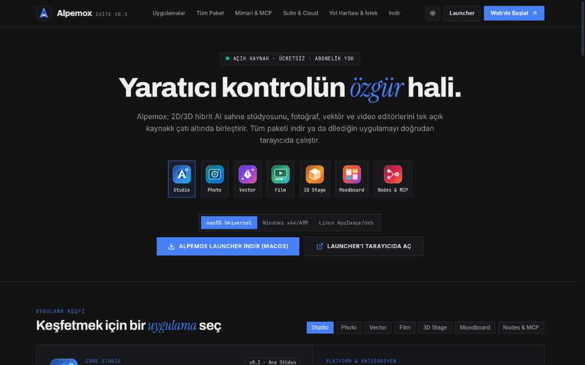
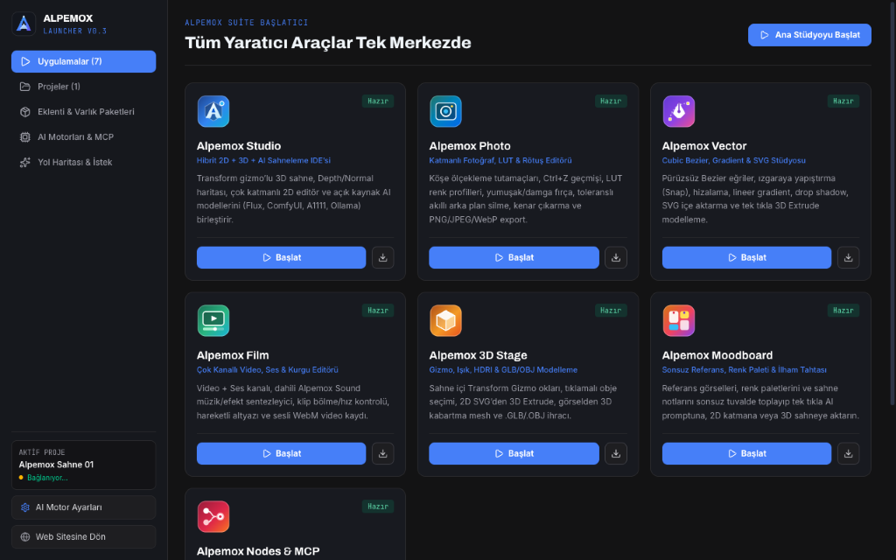
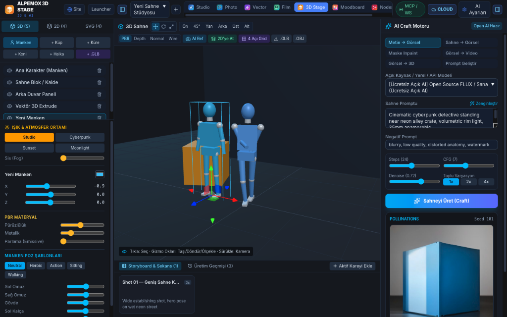
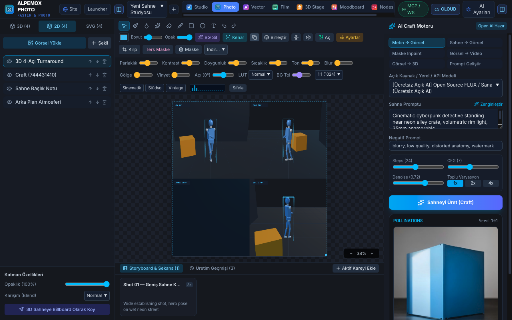
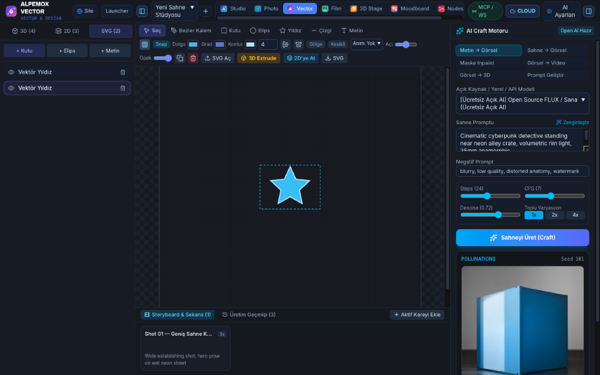
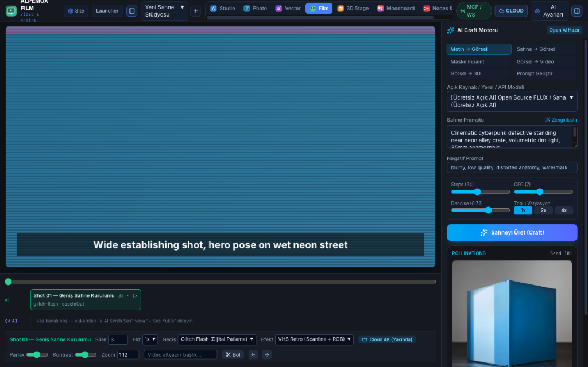

<div align="center">


# Alpemox Creative Suite

**Open-source (AGPL-3.0) 2D Photo, Bezier Vector, Multi-track Film, Three.js 3D Stage, Local AI Hub & MCP Agent Platform.**

[🇹🇷 Türkçe README](README.tr.md) · [🐛 Report Bug / Request Feature](https://github.com/ZypherStudio/alpemox/issues) · [🤝 Contributing](CONTRIBUTING.md) · [🗺️ Roadmap](ROADMAP.md)

[](LICENSE)
[](package.json)
[](apps/studio/package.json)
[](apps/studio/src/components/Stage3DViewport.tsx)
[](packages/mcp/bin/opencraft-mcp.mjs)

</div>

---

**Alpemox** brings together layered raster photo retouching, Bezier vector design, multi-track video/motion editing, an articulated Three.js 3D stage, node-based AI pipelines, and live **MCP agent control** in one local-first, zero-subscription open suite.

Inspired architecturally by [ArtCraft](https://github.com/storytold/artcraft) (MIT / Apache-2.0) — full attribution & trademark boundaries live in [NOTICE](NOTICE).

## ✨ Visual Showcase

<table>
  <tr>
    <td width="50%">
      <strong>Alpemox Website & Suite Dock</strong><br/>
      
    </td>
    <td width="50%">
      <strong>Unified Suite Launcher</strong><br/>
      
    </td>
  </tr>
  <tr>
    <td width="50%">
      <strong>3D Stage (PBR + Gizmo + Mannequin)</strong><br/>
      
    </td>
    <td width="50%">
      <strong>Photo Editor + 3D 4-Angle Turnaround</strong><br/>
      
    </td>
  </tr>
  <tr>
    <td width="50%">
      <strong>Vector Editor (Bezier, Polygon, CSS Motion SVG)</strong><br/>
      
    </td>
    <td width="50%">
      <strong>Film Editor (Multi-track Timeline + Motion + Synth)</strong><br/>
      
    </td>
  </tr>
</table>

## 🧩 7 Integrated Modules

| Module | What It Does |
| :--- | :--- |
| **Alpemox Studio (Hybrid)** | Live **2D ↔ 3D bridge**: pose a 3D mannequin, capture RGB + Depth, paint/mask in 2D, craft with AI, and project back onto the 3D stage as a billboard. |
| **Alpemox Photo** | Multi-layer canvas, drag-and-drop image import, live luminance histogram, `Teal & Orange / Kodak / Noir` LUT presets, temperature, vignette, blur, drop shadow, crop, merge visible layers, Sobel edge extraction, client-side background removal, and invert inpaint mask. |
| **Alpemox Vector** | Smooth Cubic Bezier pen with draggable anchor points, shapes (`Rect`, `Ellipse`, `Star`, `Polygon`, `Line`, `Text`), corner radius, dashed strokes, CSS keyframe motion presets (`Pulse`, `Spin`, `Float`), SVG import/export, and 1-click **3D Extrude**. |
| **Alpemox Film** | `V1 + A1` video & AI Synth audio tracks, `16:9 / 9:16 / 1:1` aspect ratios, shot motion presets (`Ken Burns`, `Pan`, `Float`, `Bounce`), kinetic titles (`Typewriter`, `Pop`, `Fade Up`), transitions (`Glitch Flash`, `Zoom Whip`, `Wipe`), filters (`VHS Retro`, `Bloom`), **AI Storyboard Auto-Fill**, and **audio-mixed `.webm` export** (`720p/1080p/4K`). |
| **Alpemox 3D Stage** | Interactive Three.js viewport with `TransformControls` gizmo, raycaster selection, PBR material sliders (`Roughness`, `Metalness`, `Emissive`), joint mannequin posing, HDRI/fog lighting presets, **4-Angle Turnaround Grid**, heightmap `3D Relief`, SVG extrusion, and `.GLB` / `.OBJ` export. |
| **Alpemox Moodboard** | Infinite drag-and-drop canvas for reference photos, director notes, color palettes, and AI craft outputs. |
| **Alpemox Nodes & MCP** | Node workflow graph (`.alpemox-flow.json`), **MCP `stdio` server** (`npm run mcp`), CLI (`npm run cli`), and live WebSocket synchronization (`/ws`). |

## 🤖 Open Local-First AI Engines

All core editors and exports run locally **100% free & unlocked under AGPL-3.0**:
- **Zero-Key Free Cloud AI:** Built-in **Pollinations FLUX / Sana** support (`1x–4x` batch variations).
- **Local GPU:** Automatic checkpoint & LoRA discovery for **ComfyUI** (`127.0.0.1:8188`), **Automatic1111 / Forge** (`127.0.0.1:7860`), and **Ollama** (`127.0.0.1:11434`).
- **BYOK Optional:** Connect **OpenAI**, **Google Gemini**, or **Fal.ai** anytime, plus a deterministic **Procedural Offline Preview** engine for offline testing.

---

## 🚀 Quick Start (30 Seconds)

### Option 1: Node.js (Recommended)
```bash
git clone https://github.com/ZypherStudio/alpemox.git
cd alpemox
npm install
npm run build
node apps/server/src/index.mjs
```
Open:
- **Website:** http://localhost:4310/
- **Suite Launcher:** http://localhost:4310/?page=launcher
- **Creative Studio:** http://localhost:4310/?page=studio

### Option 2: Docker Compose
```bash
git clone https://github.com/ZypherStudio/alpemox.git
cd alpemox
docker compose up --build
```

### Option 3: Development & Tests
```bash
npm run dev    # Runs Vite (:5173) + Server (:4310) together
npm test       # Runs unit, REST API, WebSocket, and MCP stdio integration tests
```

---

## 🔌 Connect AI Agents via MCP

Let Claude Desktop, Cursor, Antigravity, or custom agents manipulate 3D mannequins, add layers, craft AI assets, and run pipelines live via WebSocket:

```json
{
  "mcpServers": {
    "alpemox": {
      "command": "node",
      "args": ["<ALPEMOX_DIR>/packages/mcp/bin/opencraft-mcp.mjs"],
      "env": {
        "OPENCRAFT_SERVER_URL": "http://127.0.0.1:4310"
      }
    }
  }
}
```

Available CLI shortcuts (`npm run cli -- <command>`): `health`, `state`, `pose`, `add-3d`, `craft`.

---

## 🌟 Support & Contribute

If **Alpemox** saves you time or inspires your workflow, **drop a ⭐ Star on GitHub** and check out our [`good first issue`](https://github.com/ZypherStudio/alpemox/issues) tasks!

- See [ROADMAP.md](ROADMAP.md) for Phase 2 (**FFmpeg MP4**, **2D Bone Rigging & Lottie**, **Tauri `.dmg/.exe` installers**, and **Alpemox Cloud**).
- Licensed under **AGPL-3.0-only** ([LICENSE](LICENSE) · [NOTICE](NOTICE)).
