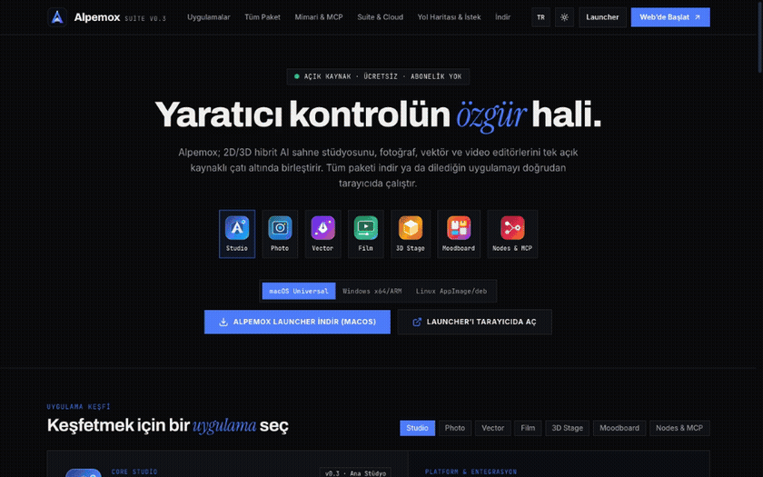
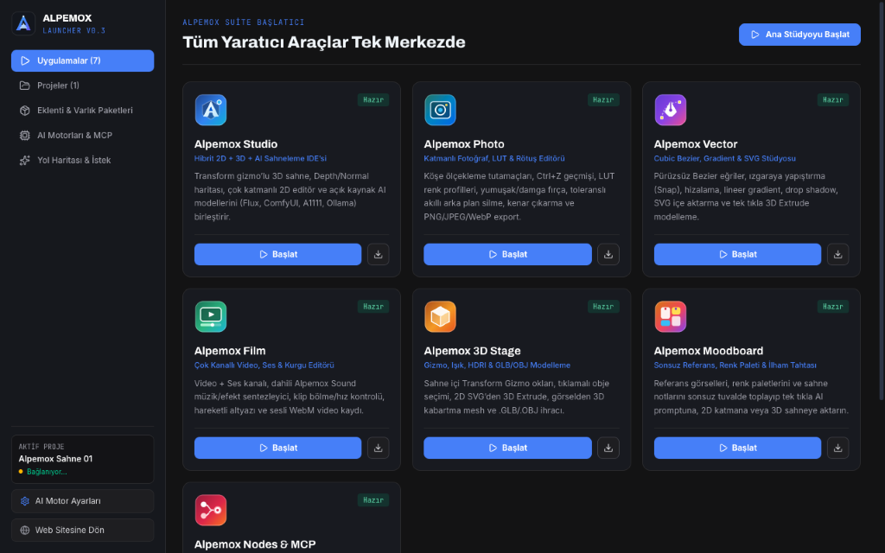
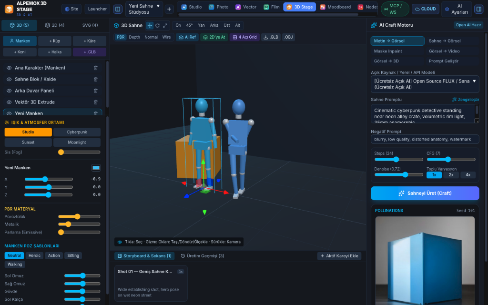
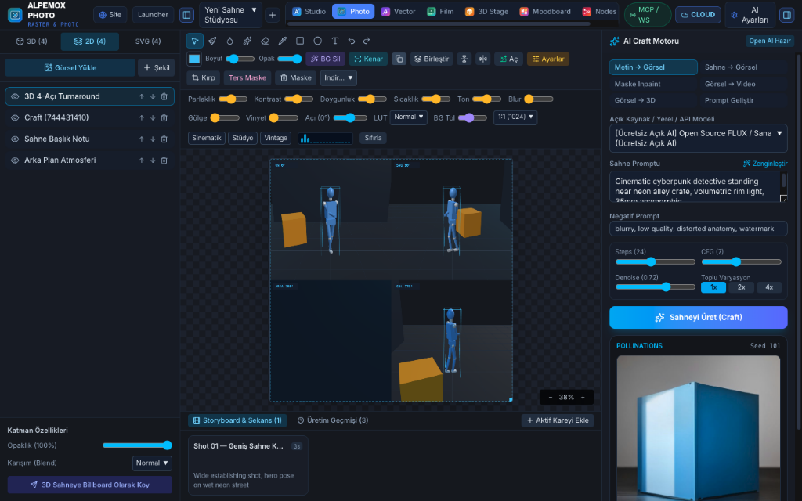
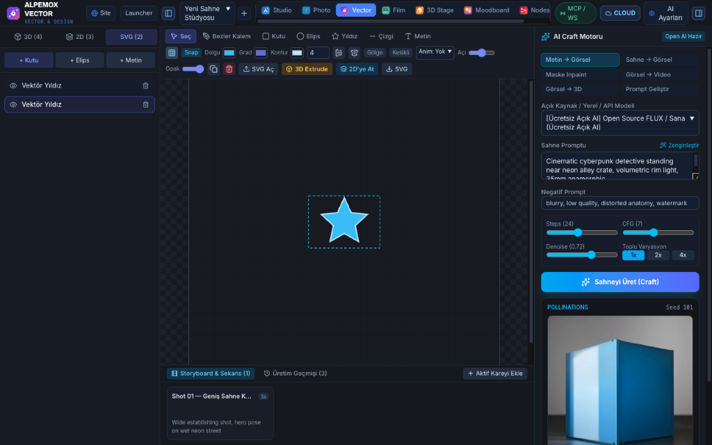
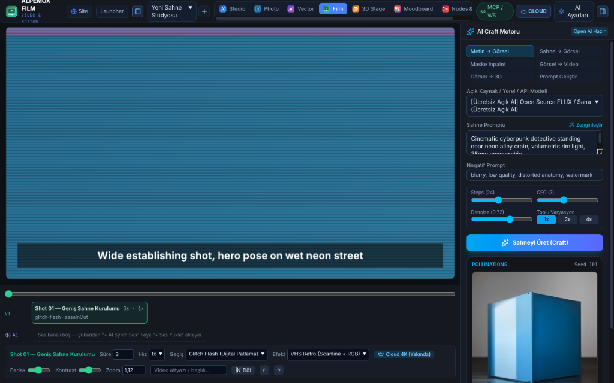

<div align="center">


# Alpemox Creative Suite

**AGPL-3.0 Açık Kaynaklı 3D Oyun Motoru (Alpemox Game ★), 2D Fotoğraf, Bezier Vektör, Çok Kanallı Video, Three.js 3D Sahne, Yerel AI Hub & MCP Ajan Platformu.**

[🇺🇸 English README](README.md) · [🐛 Hata / Özellik Bildir](https://github.com/ZypherStudio/alpemox/issues) · [🤝 Katkı Rehberi](CONTRIBUTING.md) · [🗺️ Yol Haritası](ROADMAP.md)

</div>

---

**Alpemox**; **yıldız modülü Alpemox Game v3 (animasyonlu 3D karakter, Takipçi/Taret düşman AI, Kalkan+Mıknatıs Power-Up, canlı Radar Mini-Map, Grid Snap Gizmo, Prompt → 3D Oyun Üretici, Chiptune synth müzik, kodsuz Olay Kuralları & tek dosya `.HTML` export)**, çok katmanlı fotoğraf editörü, Bezier vektör tasarımı, çok kanallı video/animasyon kurgusu, pozlanabilir Three.js 3D sahnesi, düğüm tabanlı AI akışları, canlı `TR/EN` dil desteği ve canlı **MCP ajan kontrolünü** abonelik dayatmayan tek açık kaynak çatı altında toplar.

Mimari yaklaşımı [ArtCraft](https://github.com/storytold/artcraft) (MIT / Apache-2.0) açık kaynak projesinden ilham alır (`OrbitSphere` 3D kamera açısı küresi doğrudan uyarlanmıştır); atıf ve marka sınırları [NOTICE](NOTICE) dosyasındadır.

<div align="center">
  
</div>

## ✨ Ekran Görüntüleri

| Web Sitesi | Suite Launcher |
| :---: | :---: |
|  |  |
| **3D Sahne (PBR + Gizmo)** | **Photo + 4-Açı Turnaround Grid** |
|  |  |
| **Vektör (Bezier, Poligon, Animasyonlu SVG)** | **Film (Çok Kanallı Timeline + Synth Ses)** |
|  |  |

## 🚀 Hızlı Başlangıç

```bash
git clone https://github.com/ZypherStudio/alpemox.git
cd alpemox
npm install
npm run build
node apps/server/src/index.mjs
```

- **Web Sitesi:** `http://localhost:4310/`
- **Launcher:** `http://localhost:4310/?page=launcher`
- **Stüdyo:** `http://localhost:4310/?page=studio`
- **Docker:** `docker compose up --build`
- **Geliştirme & Test:** `npm run dev` · `npm test`

## 🔌 MCP Ajan Entegrasyonu

```json
{
  "mcpServers": {
    "alpemox": {
      "command": "node",
      "args": ["<ALPEMOX_KLASORU>/packages/mcp/bin/opencraft-mcp.mjs"],
      "env": {
        "OPENCRAFT_SERVER_URL": "http://127.0.0.1:4310"
      }
    }
  }
}
```
